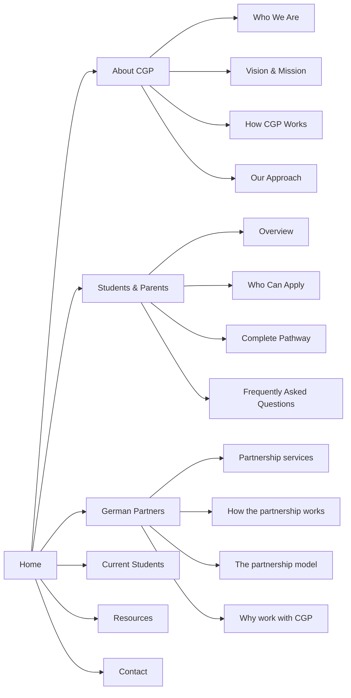

<div align="center">

# Ceylon German Pathway — Official Website

### The Sri Lankan pathway to a nursing career in Germany 🇱🇰 → 🇩🇪

A ten-page static website in the Swiss International Typographic style — German flag tricolor, hard-cropped black-and-white photography, zero frameworks, zero dependencies, zero tracking.

<br>


---

**Black `#000000` · Red `#DD0000` · Gold `#FFCE00`** — the tricolour runs through every page, from the header rule to the footer.

</div>

---

## ✦ Overview

CGP connects Sri Lankan nurses and healthcare professionals with careers in Germany — German language training, the Nursing Ausbildung pathway, and partnership with German healthcare institutions. This repository is the complete public website: **ten pages, six printable guides, one design system.**

- **Fully static** — plain HTML, CSS and vanilla JavaScript. No build step, no frameworks, no CDN links, no tracking.
- **Works offline** — every asset is stored locally. Open `index.html` and it just works.
- **Accessible by default** — keyboard navigation, ARIA tabs/accordions, `prefers-reduced-motion`, contrast-checked at WCAG AA.

## ✦ Pages

| Page | Purpose |
|------|---------|
| [Home](index.html) | Three rotating hero banners plus eight approved sections |
| [About CGP](about.html) | Four sections: Who We Are, Vision & Mission, How CGP Works, Our Approach |
| [Students & Parents](students.html) | Section landing page: the client's hero banner, twelve services, programme transparency |
| [Who Can Apply](who-can-apply.html) | Eligibility and the personal commitment CGP asks for, plus the no-guarantee notice |
| [Complete Pathway](complete-pathway.html) | The fifteen-stage pathway in five phases, with CGP's role and the institution's role separated |
| [Frequently Asked Questions](faq.html) | The sixteen questions students and parents ask most, in an accordion |
| [German Partners](partners.html) | Partnership services and the seven-stage partnership process |
| [Current Students](current-students.html) | Progress board and support along the pathway |
| [Resources & Downloads](resources.html) | Guides, full FAQ, plain-English German glossary |
| [Contact](contact.html) | Contact details and the enquiry form |

The four pages under **Students & Parents** are the section's content; `students.html` is the section landing page. The main navigation shows the three pages inside the section under the **Students & Parents** caret (Who Can Apply · Complete Pathway · Frequently Asked Questions), exactly as the client specified.

Each of the six **downloadable guides** (`downloads/`) is a self-contained printable page — document checklist, fee policy, FAQ, German language starter guide, Nursing Ausbildung pathway guide, and a pre-departure checklist.

## ✦ The main navigation

The main navigation follows the client's proposed menu (see *Changes Home
page.docx*), and every item in it is a real destination:

```
Home · About CGP ▾ · Students & Parents ▾ · German Partners ▾ · Current Students · Resources · Contact
```

- **A label is a link; the caret beside it is a button.** "About CGP",
  "Students & Parents" and "German Partners" point at their own page, and the
  caret button opens that section's menu. Nothing is reachable only from inside
  a menu, and no top-level item is a dead end.
- **About CGP** → Who We Are · Vision & Mission · How CGP Works · Our Approach —
  the client's four items, anchored to sections on `about.html`.
- **Students & Parents** → Overview · Who Can Apply · Complete Pathway ·
  Frequently Asked Questions. The client's three content pages are exactly those
  three, and only those three; the client's instruction that the dropdown
  contain only them (and that the Fee & Payment Policy page come off the menu)
  is met. The leading **Overview** entry is the section's own landing page —
  the page carrying the client's hero banner. It is there because this is the
  one section menu whose items are all *other* pages: without it, the section's
  own page appeared nowhere in the menu. Read the comment on `STUDENTS_SUBMENU`
  in `build-pages.py` before removing it.
- **German Partners** → Partnership services · How the partnership works · The
  partnership model · Why work with CGP. The client's proposed navigation shows
  this as a dropdown but has not named its items, so the page's own section
  headings are used, the same rule About CGP follows. Swap the four entries in
  `PARTNERS_SUBMENU` (`build-pages.py`) when the client supplies their own.
- Menu item text is always the target section's own heading, so a menu item
  cannot drift out of step with the page it points at. `verify-menu.py` checks
  that every one of the eleven menu links resolves to a real target.
- `aria-current="page"` marks the link to the page you are on;
  `aria-current="true"` marks the section that page belongs to (for example the
  Students & Parents label while you are on the FAQ page).

### Menu destinations at a glance



## ✦ Run it

The folder is self-contained — keep it together. Then either:

**Double-click `index.html`** — the whole site works, including navigation between pages.

Or serve it over HTTP (closer to production):

```bash
python3 -m http.server 4173
# → http://localhost:4173
```

## ✦ Deployment

**Live site:** https://cgp.lk — StackCP shared hosting (account `devtenent.com`),
docroot `~/cgp.lk`, which is a **git clone of
[PubuduDissanayaka/CGP](https://github.com/PubuduDissanayaka/CGP) (public repo)**.
Nothing else serves this site; there is no separate upload step.

Deploying is therefore three steps:

```bash
# 1. copy the built site over a clone of the repo (never the client's working
#    documents: Hero-Slide/ and the .docx change requests stay out of the
#    public repo — they live in hermes-sync instead)
rsync -a --exclude Hero-Slide/ --exclude '*.docx' <build-dir>/ <clone>/
cd <clone> && git add -A && git commit -m "..." && git push origin main

# 2. pull on the server
ssh -i ~/.ssh/id_ed25519 -o BatchMode=yes devtenent.com@ssh.us.stackcp.com \
  'cd ~/cgp.lk && git pull --ff-only origin main'

# 3. verify from outside — always with a cache-busting query string
curl -sS "https://cgp.lk/students.html?cb=$(date +%s)" | grep -o 'styles.css?v=[0-9]*'
```

**Rollback:** the docroot is a clean clone, so one line reverts it —

```bash
ssh devtenent.com@ssh.us.stackcp.com 'cd ~/cgp.lk && git reset --hard <previous-sha>'
```

**Cache gotcha (measured 2026-10-15).** StackCDN's edge cache keeps `.html`
responses for 24 hours and does **not** notice that the files changed, so after a
deploy some URLs keep serving the previous page until their TTL expires. On
2026-10-15 the homepage `/`, `/students.html` and `/about.html` were still on the
old build for up to 24 h while everything else was already current; the menu
structure deploy later the same day hit the same thing — `/partners.html` served
the previous page (no `submenu-partners`, no `nav__row`) straight after the push,
with `expires` set 24 h ahead, while the same URL with `?cb=<timestamp>` served
the new build. The fix is the **Edge Caching → purge** control in the StackCP
panel; otherwise it clears itself within 24 h. Note `/` and `/index.html` are
**separate cache entries** — check both. Always probe with `?cb=<timestamp>`,
because a plain probe caches the page you are trying to verify.

Deployed 2026-10-15 from the locally verified build: repo commit `9dc4f8d`, the
menu structure change (see the menu structure change request below). It follows
`71a47df`, which carried the 2026-10-12 (home page / About CGP) and 2026-10-15
(Students & Parents) change requests.

**Deploy history**

| Date | Repo commit | Contents |
|------|-------------|----------|
| 2026-08-24 | `3777054` | Initial release of the seven-page site (was live until 2026-10-15) |
| 2026-10-15 | `71a47df` | Students & Parents rebuild + 2026-10-12 home page / About CGP changes |
| 2026-10-15 | `9dc4f8d` | Menu structure: client's proposed navigation, German Partners section menu, navigating labels, anchor offset |
| 2026-10-15 | `9dbb26d` | Follow-up: the Students & Parents page listed in its own menu as **Overview** |
| 2026-10-16 | `51d1059` | Footer credits: **Developed by DevTenent** link, new tab → devtenent.com |
| 2026-10-16 | `c35105e` | **Performance pass** (DEVT-87): 109 responsive WebP/JPEG derivatives in `assets/images/opt/`, every `` rewritten as `<picture>` with `srcset`/`sizes`, minified merged stylesheet + JS, `?v=14`, below-fold images deferred, plus `.htaccess` caching/MIME rules. Home page 3,614 KB → 798 KB, site 8.22 MB → 1.83 MB, Lighthouse mobile 0.75 → 0.99, LCP 12.5 s → 2.3 s, text unchanged on all ten pages |
| 2026-10-16 | `67c59a9` | **Generated imagery**: the twelve Unsplash placeholder photographs replaced with purpose-generated images under `assets/images/gen/` + `opt/gen/`; `make-opt.py` + `images-gen.json` added. Client artwork (`hero-banner-01..03`, `hero-students-parents`) deliberately unchanged. Home page 798 KB → 648 KB, site 1.83 MB → 1.48 MB |

**Rollback:** `git reset --hard 6975a46` on the server returns the site to the
build that was live before the menu work; `git reset --hard f3ecd16` keeps the
menu change and drops only the follow-up item. `git reset --hard f72931a`
undoes the 2026-10-16 performance pass. One line either way — the docroot
is a clean clone. Note that a host-only reset is undone by the next
`git pull` once the commit is on `origin/main`: to revert permanently, push a
revert commit and pull — never force-push this client repository.

Full deploy record, probe transcripts and measurement reports for the
performance pass: `../deploy-log/2026-10-16-cgp-perf-pass-deploy.md`. Baseline
and the re-runnable measurement method: `../perf-baseline-20261016/README.md`
(measured with `measure-page-weight.py` in this folder — pass `--bust` when
measuring the live site, because StackCDN serves a cached `.html` for up to
24 h and will otherwise report the previous build's numbers).

## ✦ Structure

```
.
├── index.html … contact.html   The ten pages — this is the deliverable
├── css/
│   ├── tokens.css              Design tokens: colour, type scale, spacing, grid, motion
│   └── styles.css              All component styles — references tokens only
├── js/
│   └── main.js                 Nav, accordions, tabs, journey rail, form, scroll reveal
├── assets/
│   ├── images/                 Photography masters + logo (JPEG + WebP pairs)
│   │   ├── gen/                Generated masters, 2026-10-16 — see §Generated imagery
│   │   └── opt/                Responsive derivatives the pages actually load
│   │       └── gen/            Derivatives of the generated masters
│   ├── fonts/                  Empty — the site uses the native Helvetica stack
│   └── icons/                  Reserved
├── downloads/                  Six printable PDF-style guides (self-contained HTML)
├── Hero-Slide/                 Client-supplied banner artwork (PNG masters)
├── build-pages.py              Optional dev tool — generates the shared chrome
├── make-opt.py                 Optional dev tool — builds assets/images/opt/ derivatives
├── images-gen.json             Manifest for make-opt.py (the generated image set)
├── verify-menu.py              Menu contract check — run after any nav change
├── Changes Home page.docx      Client change request, 2026-10-12
├── Website - Students.docx     Client change request, 2026-10-15
└── README.md
```

### About `build-pages.py`

This generated eight of the ten pages so the header, navigation and footer are byte-identical across the site. **It is not required to run or edit the site** — the `.html` files are complete and safe to hand-edit.

The main navigation lives in `nav()` in that script: `SECTION_MENUS` names the three sections that carry a menu, and `ABOUT_SUBMENU` / `STUDENTS_SUBMENU` / `PARTNERS_SUBMENU` are their items. The About page's four sections are generated from the `ABOUT` template below it. Changing any of it means changing the script, then re-running it.

> ⚠️ If you hand-edit shared chrome (header/nav/footer) inside a generated page, either mirror the change into the script or delete the script — otherwise the next run overwrites your edit. `index.html` is hand-maintained and is never touched by the script.

### Checking a menu change

`python3 verify-menu.py` asserts the whole menu contract and exits non-zero on any
break: the generator is idempotent, every page carries `?v=` the same version,
every page has one `<h1>` and no duplicate ids, all ten pages render the same
nav in the client's order, every one of the eleven menu links resolves to a real
page or anchor, and `aria-current` is on the right link for every page. Run it
after any change to `nav()`, the submenus or the menu markup.

### Cache busting

CSS and JS are referenced as `css/styles.css?v=13`. When you change either file, bump `ASSET_VERSION` in `build-pages.py`, re-run it, and change the matching `?v=` numbers in `index.html`.

## ✦ Design system

Swiss International Typographic Style: a strict 12-column modular grid, flush-left ragged-right text, extreme contrast between oversized display type and small body copy, thin hairline rules, numbered sections, sharp corners (no rounding, no shadows), and hard-cropped black-and-white photography. **No two sections repeat the same layout.**

- **Brand colours** are the German flag palette — black `#000000`, red `#DD0000`, gold `#FFCE00`. Red is the single bold accent; gold appears sparingly (labels on dark sections, the active tab, the tricolour rule above the header).
- **Photography** is stored in colour and rendered black-and-white by the `.img-bw` class, so the treatment can be changed or removed in one place.
- **Fonts** — the native Helvetica stack (`Helvetica Neue → Helvetica → Liberation Sans → Arial`). No font files shipped, no licence needed. Drop licensed `.woff2` files into `assets/fonts/` later and they take priority automatically.

## ✦ Before launch — placeholders to replace

| Item | Where | Note |
|------|-------|------|
| **Logo** | `assets/images/CGPLogo.png` | Live in header, footer and favicon |
| **Testimonials** | `current-students.html` | Clearly labelled "Sample testimonials" — replace with real, verified quotes |
| **Statistics** | About, Current Students | Client-supplied working placeholders, each with a visible footnote. The counters on the **home** page's About section were removed at the client's request (2026-10-12) |
| **Photography** | `assets/images/` | The Unsplash placeholders were replaced on **2026-10-16** by purpose-generated photography — see *§Generated imagery* below. The Students & Parents hero banner **and** the three home-page slider banners remain the client's own supplied artwork (`Hero-Slide/*.png` → `hero-students-parents.*`, `hero-banner-01..03.*`) and were deliberately not regenerated |
| **Favicon** | `<link rel="icon">` | Currently points at `CGPLogo.png`; a square mark-only export would be sharper |

**Enquiry form:** `contact.html` opens the visitor's email app pre-filled (static site, no backend). Before launch, consider pointing `form.action` at a form service (Formspree, Netlify Forms…) so enquiries arrive reliably — handler marked in `js/main.js`.

## ✦ Generated imagery — 2026-10-16

Twelve of the site's content photographs were replaced with purpose-generated
photography. The brief was *"generated images relevant to the website content, at the right
places"*, with two hard exclusions.

**Deliberately not touched** (client-supplied artwork, verified byte-identical before/after):

| Kept | Where |
|------|-------|
| `hero-banner-01..03.{jpg,webp}` | Home page slider — from `Hero-Slide/` |
| `hero-students-parents.{jpg,webp}` | Students & Parents page banner — from `Hero-Slide/` |

**Replaced** — the Unsplash placeholders that were only ever "visual direction":

| New master | Widths served | Page / slot |
|---|---|---|
| `gen/students-group` | 640/1024/1600 | about.html band · home "Current Students" tab |
| `gen/student-writing` | 640/1024/1600 | who-can-apply.html band · home tab |
| `gen/books-study` | 640/1024/1600 | resources.html band |
| `gen/clinical-review` | 640/1024/1600 | partners.html figure |
| `gen/medical-team` | 640/1024/1600 | partners.html band · home "German Partners" |
| `gen/hero-nurse` | 640/1024/1600 | contact.html figure |
| `gen/students-laptop` | 640/1024 | current-students tab 1 · home "About CGP" |
| `gen/documents-desk` | 640/1024 | current-students tab 2 · home tab |
| `gen/airport-departure` | 640/1024 | current-students tab 3 (visa stage) |
| `gen/germany-berlin` | 640/1024 | current-students tab 4 (in Germany) · home tab |
| `gen/germany-town` | 640/1024 | home "Why Germany" |
| `gen/nurse-care` | 640/1024 | about.html "Who We Are" figure |

### Why new filenames instead of overwriting

`.htaccess` marks `assets/images/opt/*` as `max-age=31536000, immutable`, so overwriting a
file at an existing URL would leave returning visitors on the old placeholder for up to a
year. The new set therefore lives under **`gen/`** — a new namespace, new URLs, no stale
cache — and every old file is left on disk untouched, which also makes the change revertible
by swapping attribute values back.

### Rebuilding the derivatives

`make-opt.py` is the tool that was missing from the 2026-10-16 performance pass. It reads
`images-gen.json` and produces, per image, a JPEG + WebP master and the `opt/` derivatives:

```bash
python3 make-opt.py --manifest images-gen.json          # build
python3 make-opt.py --manifest images-gen.json --check  # verify only
```

It refuses rather than upscales: a requested width above the master width is an error. JPEG
`-q:v 4` and WebP `-quality 78` were calibrated against the pre-existing derivative set, not
guessed.

### Provenance and cost

Masters, the exact prompts, the generation harness and two rejected attempts live outside
this repo, in `../../image-generation-20261016/` — i.e. `Website/image-generation-20261016/`
on the dev host, a sibling of `website-build-files/` (mirrored to the other runtime through
`hermes-sync`, never published). Prompts asked for black-and-white-friendly documentary
photography in the site's Swiss-institutional register, with no text, signage, logos or
watermarks. Twelve images were produced with **OpenAI `gpt-image-2`** at `medium`, sized to
each slot's largest served derivative (1600×1072 for full-bleed bands, 1056×704 for column
figures) so nothing is upscaled. The `gemini` connection was the intended provider for the
six column figures but its API key is free-tier and reports `limit: 0` for every image
model, so it produced nothing.

### Effect on weight

Every page whose images changed got **lighter**, because the generated photographs are
tonally flatter than the colour stock photos they replace. Local measurement
(`measure-page-weight.py`, 16 URLs):

| | before | after |
|---|---|---|
| home page | 865 KB | **715 KB** |
| site total | 2.40 MB | **2.06 MB** |

`students.html`, `complete-pathway.html`, `faq.html` and the six `downloads/` pages are
byte-identical to the previous build.

## ✦ Content & compliance

- All copy is drawn from the completed client questionnaire and the client's own change requests — nothing invented.
- Banned phrases (guaranteed visa/job/placement, 100% success, "easy way to Germany", "no German required", unrealistic salary claims) are **not used anywhere** — please keep it that way when editing.
- The Students & Parents section is explicit that CGP prepares and supports candidates but does **not** guarantee or sell Ausbildung positions: final assessment and selection remain with the German institution. That wording is deliberate and appears on the Who Can Apply, Complete Pathway and FAQ pages.
- No fee table is published in the Students & Parents section (client instruction, 2026-10-15). Costs are explained to each candidate directly, before enrolment.
- Case studies are labelled as illustrative of the service model, not completed cases.
- Unverified figures carry visible footnotes rather than being presented as fact.

## ✦ Accessibility

Semantic HTML with one `<h1>` per page; alt text on every image; a skip link; visible focus states; WAI-ARIA tabs and accordions that work by keyboard; `aria-current` on the active nav item; `prefers-reduced-motion` honoured. Body text is 18px with contrast checked on both light and dark sections.

## ✦ Security

- **No secrets in the repo** — no API keys, credentials, or environment files. The only contact data present is CGP's public business details (WhatsApp, `hello@cgp.lk`).
- Client-confidential working files (questionnaire, build prompts, client requirements) are **git-ignored** and never pushed.
- All external links use `rel="noopener"`.

## ✦ Known follow-ups

- **Image weight** — `assets/images/` is ~7 MB (JPEG + WebP pairs already added). Running the remaining JPEGs through an optimiser would roughly halve page weight — matters for mobile visitors in Sri Lanka.
- **Favicon** has not been created — it needs the logo file first.

---

<div align="center">

**© 2026 Ceylon German Pathway** — Built by [DevTenent](https://devtenent.com) · Colombo, Sri Lanka

</div>

## ✦ Client change request — 2026-10-12

Applied from `Changes Home page.docx` plus the three banner artworks in `Hero-Slide/`.
Recorded here so the next editor knows what was deliberate.

**Home page**

- Hero replaced by a three-banner accessible slider (`[data-hero-slider]` in the markup,
  driven by `js/main.js`). Source artwork is PNG in `Hero-Slide/`; the site loads
  `assets/images/hero-banner-01..03.jpg` (with matching `.webp` spares). Each banner is
  shown whole — never cropped — and its headline is repeated as real text in the caption
  underneath, which is what mobile visitors actually read. The male nurse portrait
  (`hero-portrait.jpg/.webp`) is no longer used; the file is still on disk.
- Home page section order (owner instruction, 2026-10-12): the **banner slider leads the
  page**, immediately under the header, and the headline band (kicker · H1 · lede ·
  enquiry buttons) is the next section below it — followed by the three-fact strip, then
  `About CGP`. The hairline rule that used to sit between the band and the slider now sits
  above the band, and the slider no longer draws its own top rule against the header's.
- `ASSET_VERSION` / `?v=` raised to **11** across all seven pages for this change.
- The About CGP section: statistics counters removed, the "transparent fees and documented
  policies" principle replaced, and a **Learn more about CGP** button added. Copy aligned to
  the client's eight-stage pathway wording.
- Why Choose CGP: the "Transparent fees" card removed and the remaining cards renumbered
  3.1–3.6, with a "Cultural & professional preparation" card added to cover the themes the
  client listed.

**About CGP**

- Main navigation: "About CGP" is now a dropdown (Who We Are · Vision & Mission · How CGP
  Works · Our Approach), anchored to sections on `about.html`. The nav label "Resources &
  Downloads" was shortened to "Resources" to match the client's proposed navigation.
- The page was re-headed into those four sections; the previous "What we believe",
  "What makes us different" and "How we work" copy is retained inside them.
- New eight-stage pathway diagram (`#how-cgp-works`, `.pathway`), stages named exactly as the
  client listed them.
- New "Our Approach" section — the client's eight points, verbatim.

**Accessibility follow-up — 2026-10-12 (review findings)**

Two defects reported by the review pass and fixed here; neither changes any rendered
pixel, both are attribute-only edits:

- `index.html` — the hero slider (`div.hero-slider[data-hero-slider]`) carried
  `aria-roledescription="carousel"` and `aria-label` but no `role`, so the carousel was not
  exposed to assistive technology at all. Added `role="region"`; Chrome's accessibility
  tree now reports `region · "CGP in three banners"`.
- `partners.html` — `section[aria-labelledby="pmodel-title"]` referenced an id that did not
  exist, leaving the section unnamed. The id now sits on its own heading
  (`<h2 class="section-head__label" id="pmodel-title">`). `section_head()` in
  `build-pages.py` takes an optional `label_id` argument and the partners call passes it, so
  a regeneration reproduces the fix; the argument is optional and every other call renders
  byte-identically.

Known, deliberate, and *not* fixed here (recorded on the Multica issue, awaiting the owner's
call): the low-contrast slider dot marks and `.section-head__meta` label colour (WCAG AA
contrast findings from the design review), and the design review's recommendation to obtain
banner artwork in the site's own visual language.

**Still to confirm with the client** (see the Multica issue): which supplied artwork belongs
to which banner, the Vision and Mission wording, and whether the placeholder statistics should
also come off the About and Current Students pages. *(The Students navigation item became a
dropdown on 2026-10-15; the German Partners item followed on 2026-10-15 — see the menu
structure change below.)*

## ✦ Client change request — 2026-10-15

Applied from `Website - Students.docx` (*Website Amendment – Students Section*) plus the
client's Students & Parents banner artwork. The section was rebuilt around the client's three
pages.

**Students & Parents section**

- The main navigation's **Students** item became a **Students & Parents** dropdown containing
  exactly the three pages the client listed: **Who Can Apply**, **Complete Pathway** and
  **Frequently Asked Questions**. It uses the same disclosure-menu pattern as About CGP
  (`[data-nav-menu]` in `js/main.js`; no JS changes were needed).
- `students.html` is now the section landing page: the client's supplied banner artwork,
  the headline band (real text, not text baked into the image), a three-card "Start here"
  listing the three pages, the twelve student services, and the **Programme Information &
  Transparency** statement.
- **Fee & payment policy content removed** from the public Students section: the fee table,
  the fee wording in the intro and the fee question in the old FAQ are gone, replaced by the
  client's verbatim Programme Information & Transparency statement.
- **New page `who-can-apply.html`** — the client's seven eligibility and commitment areas as
  numbered rows, the approved "This pathway asks something of you" copy, and the important
  notice that meeting CGP's criteria guarantees nothing.
- **New page `complete-pathway.html`** — all fifteen stages, grouped into five phases and each
  carrying a role badge (**CGP** or **German institution**), plus a "Two roles, one pathway"
  split so CGP's preparation role is never confused with the institution's assessment and
  selection role.
- **New page `faq.html`** — the client's sixteen questions in an accessible accordion, followed
  by the Programme Information & Transparency statement.
- New components in `css/styles.css` (§16.15): `.hero-banner`, `.route-cards` / `.route-card`,
  `.route` (phased pathway) and `.roles`. `ASSET_VERSION` / `?v=` raised to **12** on all ten
  pages, `index.html` included.
- Page numbering in the page heroes was renumbered to `Page NN / 10` and the footer's
  "Students" item renamed to "Students & Parents", so the running count stays true.
- `resources.html`: its "full FAQ" accordion now shares the single FAQ source in
  `build-pages.py`, and the note about publishing fee amounts was replaced with the client's
  transparency wording.

**Known, deliberate and awaiting the client's call** (recorded on the Multica issue):

- `downloads/fees-and-payment-policy.html` and its card on `resources.html` were **left in
  place**. The client asked for the "Fee & Payment Policy page/section" to come off the
  Students menu and the prominent public Students content, which is done; whether the separate
  printable fee-policy download should also go is a client decision, not a developer one.
- `downloads/frequently-asked-questions.html` is still the older ten-question printable
  summary, and its fee answer predates this change.
- Two earlier FAQ answers (accommodation in Germany; how to apply) are no longer in the FAQ,
  because the client's list of sixteen questions supersedes the old set. The application route
  is on `contact.html`.
- The FAQ states that nursing Ausbildung in Germany "normally runs for three years" and that
  the required German level is "normally B1 or B2". Both are the generally documented position
  and both are hedged as set by law and by the institution, but the client should confirm the
  wording before it is published.

## ✦ Client change request — 2026-10-15 (menu structure)

Applied from the two client documents together — `Changes Home page.docx` (2026-10-12, whose
closing line is the client's *Proposed Main Navigation*) and `Website - Students.docx`
(2026-10-15, whose §8 is the client's *Final Menu Structure*). The menu now matches them
exactly and follows one rule everywhere.

**The menu**

- Top level is the client's proposed navigation, in their order:
  `Home · About CGP ▾ · Students & Parents ▾ · German Partners ▾ · Current Students · Resources · Contact`.
- **`German Partners` became a caret menu.** The client's proposed navigation marks it as a
  dropdown but never names its items, so the page's own four section headings are used —
  Partnership services · How the partnership works · The partnership model · Why work with CGP.
  This is the one judgement call in the change: the client's caret is honoured, the items are
  borrowed from the page itself rather than invented, and they are one four-line list
  (`PARTNERS_SUBMENU`) to replace once the client sends their own.
- **Every top-level label is now a link, and the caret beside it is a button.** Before this,
  About CGP and Students & Parents were `<button>`s that only opened a menu, so `students.html`
  — the section landing page, and the only place the client's Students & Parents hero banner
  lives — was reachable from the footer and from inside the section but not from the main
  navigation at all. The label now goes to the page; the caret opens the menu. The Students
  & Parents menu keeps the client's three content pages and adds nothing to that list (its
  leading **Overview** entry is the section's own page — see *Follow-up* below).
- Menu item text is the target section's own heading, always, so an item and the page it points
  at cannot drift apart.
- `partners.html` sections gained the ids the new menu anchors to (`partnership-services`,
  `how-the-partnership-works`, `partnership-model`, `why-work-with-cgp`).
- Inside a section: `aria-current="page"` on the link to the page you are on,
  `aria-current="true"` on the section it belongs to — previously a sub-page such as
  `who-can-apply.html` marked nothing in the main navigation at all.
- The caret button carries its own accessible name (`"German Partners menu"`), because the
  glyph inside it is `aria-hidden`.

**Anchor landing**

- `html { scroll-padding-top: 6rem }` added to `css/styles.css`. The header is sticky and
  5rem tall, so a menu anchor used to park its heading *behind* the header: measured with the
  same probe either side of the fix, 8 of 8 section anchors were partly hidden on a 390 px
  viewport (heading top 4 px or 68 px against a header bottom of 85 px) and 1 of 8 on desktop;
  after the fix none are. This affects the four About CGP anchors as well as the four new
  German Partners ones.

**Housekeeping**

- `ASSET_VERSION` / `?v=` raised to **13** on all ten pages, `index.html` included.
- A `verify-menu.py` contract check was added (see *Checking a menu change* above).
- `js/main.js` was **not** changed: the existing `[data-nav-menu]` disclosure code already
  binds to `.nav__toggle` and `.nav__submenu`, which the new markup still provides.

**Deliberate, and not changed here**

- The footer keeps its own wording (`Resources & Downloads`), which is longer than the main
  navigation's `Resources`. The client's proposed menu governs the main navigation; the footer
  is a different surface and was left alone rather than changed without being asked.
- The German Partners item ordering and wording are a developer choice standing in for the
  client's, not a client decision — flagged on the Multica issue.

## ✦ Follow-up — the Students page was not listed in the menu

Reported on the issue straight after the menu deploy: *"I cannot see student page."* The page
itself was fine — `https://cgp.lk/students.html` served the correct Students & Parents page
(title `Students & Parents - Nursing Ausbildung Pathway`, `<h1>` "Your journey starts with
preparation."). What was wrong was that the page appeared nowhere in the menu:

- The other two section menus list places **on** their own page (About CGP's four anchors,
  German Partners' four anchors), so opening either of them shows you the section's content.
- The Students & Parents menu lists three **other** pages. Its own page — the one carrying the
  client's hero banner — was not an item, so it could only be reached by clicking the caret
  label itself, and not at all from the previous build's menu (where that label was a button).

**Change:** `STUDENTS_SUBMENU` now starts with `("students.html", "Overview")`. The client's
three content pages are untouched and still exactly three; the new first entry is the section's
own page. This is the one item in the menu that is not a client-supplied label, and it is the
first thing to remove if the client objects. The reasoning is written into `build-pages.py`
next to the list, and `verify-menu.py` now asserts that the section's own page is linked.

No CSS or JS changed, so `ASSET_VERSION` stayed at **13**.

**Why the report could not be reproduced from the server:** the deployment itself was correct —
all eleven URLs serve the new markup when fetched past the CDN (probed with `?cb=<timestamp>`).
Two things can still show a visitor the previous build, and both produce exactly this symptom,
because in the previous build the Students & Parents item is a button with no link to the
students page:

1. **StackCDN** was still serving the previous build on six of the eleven clean URLs
   (`index.html`, `students.html`, `who-can-apply.html`, `partners.html`, `resources.html`,
   `contact.html`) with 24-hour TTLs. Needs an **Edge Caching → purge** in the StackCP panel.
2. **The visitor's own browser** holds the same pages for up to 24 h under the same
   `max-age=86400`, so a hard refresh (Ctrl/Cmd + Shift + R) is needed even after a purge.

A note for anyone probing cgp.lk from a script: StackProtect (the host's WAF) returns **403**
or a "Security Verification" interstitial to Chrome-like User-Agents coming from a datacenter
IP, which makes headless verification of this site unreliable. Requests with curl's default
User-Agent pass, which is why the probes above use it. This is a probing artefact — a normal
browser on a normal connection renders the site.

## ✦ Client change request — 2026-10-16 (footer credits)

Requested on the issue: *"Update footer note. Update the footer credits also add another
developed by DevTenent hyperlink new tab open to devtenent.com."*

**Change** — one new line in `div.footer__bottom`, on all ten pages:

```html
<p class="footer__credit">Developed by <a href="https://devtenent.com" target="_blank" rel="noopener" style="text-decoration: underline">DevTenent</a></p>
```

- **Nothing was removed.** The two existing lines (`© 2026 Ceylon German Pathway. All rights
  reserved.` and `Sri Lanka → Deutschland`) are untouched; the credit is added after them.
- The link opens in a new tab, matching the footer's existing Facebook / Instagram / WhatsApp
  links (`target="_blank" rel="noopener"`).
- **The underline is an inline style, deliberately.** `a { color: inherit; text-decoration: none }`
  would otherwise leave the link identical to the text around it, which fails WCAG 1.4.1; without
  an underline the only difference would be that it is clickable. A stylesheet rule was avoided
  because `css/` is owned by the in-flight performance work (`?v=14`, `css/styles.min.css`) — an
  inline style renders the same before and after that deploy and there is no CSP to block it. The
  paragraph keeps the `.footer__credit` class so a rule in `css/styles.css` can replace the inline
  style later without touching the markup.
- `.footer__bottom` is `display:flex; justify-content:space-between`: at desktop width the three
  items read **left → centre → right** (© … / *Sri Lanka → Deutschland* / *Developed by DevTenent*);
  at 390 px the copyright takes its own row and the tagline and credit share the next. Measured
  in a real browser at 1440 px and 390 px: no horizontal overflow (`scrollWidth == innerWidth` at
  both) and no overlap.
- Accessibility: the credit inherits `.footer__bottom`'s `#9B9B9B` on the black footer —
  contrast **7.56 : 1** (WCAG AA needs 4.5 : 1) — and the underline keeps the link identifiable
  without relying on colour.
- Mirrored in `build-pages.py`'s footer template (line 367) so regenerating the nine generated
  pages keeps the line; `index.html` is hand-maintained and was edited directly. Verified by
  diff: **+1 line on each of the eleven files, nothing else changed.**

**Deployment and verification**

- Repo commit `51d1059` on `main` (`482eccb` → `51d1059`, 11 files, +11 lines); the docroot
  pulled `--ff-only` and is clean at `51d1059`.
- Probed from outside with a cache-busting query string: all **11** page URLs return `200` and
  carry exactly one `footer__credit` line with the exact `href` / `target` / `rel`; the six
  `downloads/` printables (which have their own footer) are unchanged and still `200` — 17 of 17.
- Byte delta: **+163 bytes per page**.
- **Same edge-cache caveat as every previous deploy:** straight after the push, `/`,
  `/index.html`, `/about.html` and `/contact.html` were still serving the pre-change copy with
  `expires` up to 24 h ahead (the file on the host is current — the `?cb=` probe shows the new
  line). A StackCP **Edge Caching → purge** shows it to visitors at once; otherwise it clears
  itself within 24 h.
- **Rollback:** `ssh … 'cd ~/cgp.lk && git reset --hard 482eccb'`, or `git revert 51d1059`.
  Local snapshot before the edit:
  `website-build-files/ceylon-german-pathway-cgp-website-pre-footer-credit-20261016-083124.tar.gz`.

**Noticed, not changed** — the footer's Contact column on `index.html` carries the WhatsApp
number `+94 70 400 8952` while the nine generated pages' footers do not (their list is email,
address, district, hours). This predates this change and lives in `build-pages.py`'s footer
template; it is left exactly as it was rather than fixed without being asked.

